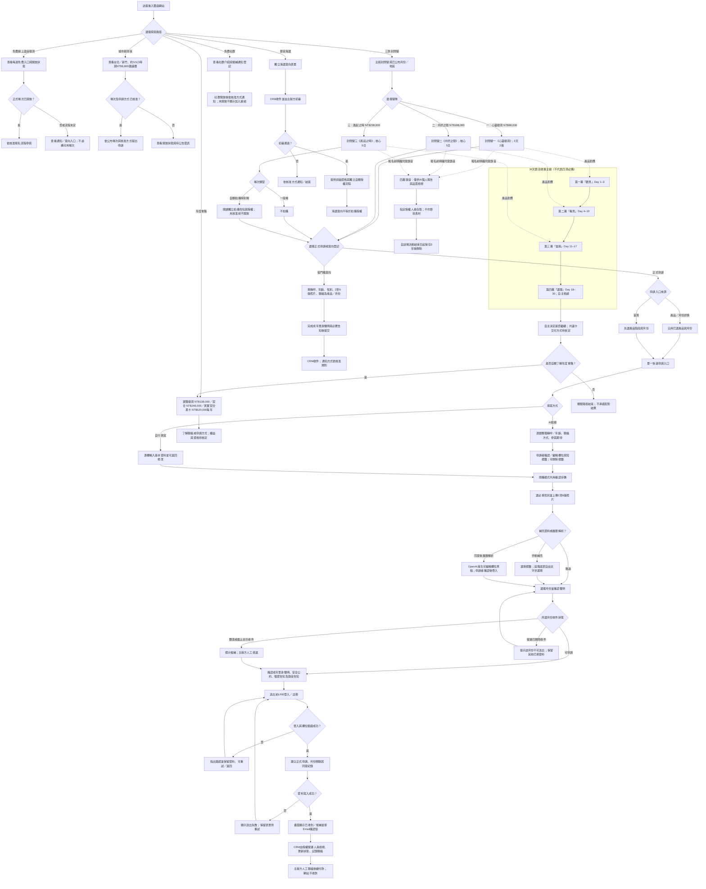
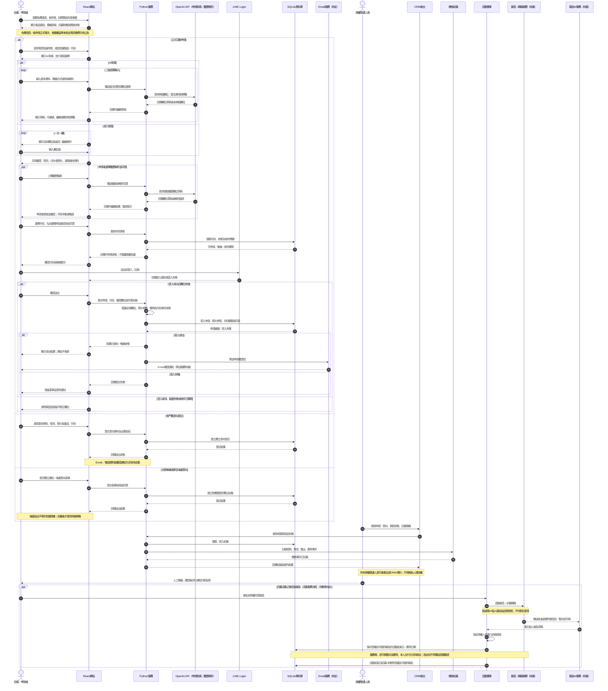

# 《心靈契合：30天，走向彼此》產品流程與資料關係

> 需求依據：`docs/prd.md` v1.16（2026-11-18）。本文件僅轉譯已確認 PRD；未定的營運、法務或技術細節列於第 4 節，不視為已核准承諾。

## 1. 訪客產品路徑與申請旅程（Flowchart）

本圖呈現免費前置體驗、付費體驗階梯、30 天四幕與首版各申請入口。三款封閉營可分開購買；第四幕是活動後自主相處，不是第四款營隊。年度會籍是可選延伸。

### 流程解讀

- 免費語音與城市樹洞夜是前置入口；封閉營一、二、三分別對應「聽見／看見／並肩」，可分開購買。四幕日程不是四個依序必購的產品。
- 第四幕「選擇」為 Day 18–30 活動後自主相處；年度會籍可選，不構成關係結果承諾。
- 首版正式申請只有一個快速申請入口，提供 AI 助填與自行填寫兩種模式。兩者共用性別、照片、月份及聲明確認。
- 申請者能複選月份；額滿或截止仍可提交候補，由主辦方人工挑選。營運關閉收件時不得提交該月申請。
- 活動錄音須在報名前明確同意，僅供 AI 個人報告及品質檢視，指定授權人員可存取，不作節目素材，活動結束日起保存三年。

## 2. 申請、AI／履歷、CRM 與活動錄音互動（Sequence Diagram）

本圖將首版網站互動和活動履約後的錄音處理分開呈現。活動語音轉錄服務商尚未選定，因此不假設由 OpenAI 處理錄音；OpenAI API 僅為申請 AI 助填與選用履歷解析的已選方向。

## 3. 核心資料實體與關係（ER Diagram）

ER 圖呈現 PRD 支持的主要資料。檔案實體以安全儲存參照而非直接把二進位內容放入 SQLite；實際儲存位置、備份及刪除策略待部署設計。欄位為流程推導模型，屬待實作驗證的資料設計假設。

```mermaid
erDiagram
    PRODUCT ||--o{ MONTHLY_SESSION : offers
    PRODUCT ||--o{ APPLICATION : receives
    MONTHLY_SESSION ||--o{ APPLICATION_MONTH : selected_for
    APPLICATION ||--|{ APPLICATION_MONTH : selects
    APPLICATION ||--|{ APPLICATION_PHOTO : includes
    APPLICATION ||--o| APPLICATION_PROFILE : optionally_has
    APPLICATION ||--o{ RESUME_FILE : may_attach
    APPLICATION ||--|{ CONSENT_RECORD : records
    APPLICATION ||--o{ CONTACT_LOG : has
    INTENT_REGISTRATION ||--o{ INTENT_MONTH : selects
    MONTHLY_SESSION ||--o{ INTENT_MONTH : interested_in
    INTENT_REGISTRATION ||--|{ INTENT_PHOTO : includes
    INTENT_REGISTRATION ||--o{ CONTACT_LOG : has
    COMMUNITY_NOTICE ||--o{ CONTACT_LOG : has
    CASTING_INTEREST ||--o{ CONTACT_LOG : has
    EVENT_SESSION ||--o{ EVENT_RECORDING : generates
    EVENT_SESSION ||--o{ EVENT_REPORT : produces
    EVENT_RECORDING ||--o{ EVENT_REPORT : source_for
    APPLICATION ||--o{ EVENT_RECORDING : participant_audio
    CONSENT_RECORD ||--o{ EVENT_RECORDING : authorizes
    CRM_OPERATOR ||--o{ CONTACT_LOG : writes
    CRM_OPERATOR ||--o{ AUDIT_EVENT : performs

    PRODUCT {
        string id PK
        string product_type
        string name_zh
        string name_en
        decimal suggested_price
        string price_unit
        string public_status
    }
    MONTHLY_SESSION {
        string id PK
        string product_id FK
        string month_key
        int capacity_internal
        string public_status
        bool intake_open
        string area_label
        datetime date_confirmed_at
    }
    APPLICATION {
        string id PK
        string product_id FK
        string line_subject_id
        string entry_mode
        string display_name
        string email
        string phone_optional
        int exact_age
        string gender
        bool adult_single_declaration
        string status
        datetime submitted_at
    }
    APPLICATION_MONTH {
        string id PK
        string application_id FK
        string session_id FK
        string status
        datetime selected_at
    }
    APPLICATION_PHOTO {
        string id PK
        string application_id FK
        string storage_key
        string mime_type
        int size_bytes
        int display_order
        datetime uploaded_at
        datetime event_ends_at
        datetime scheduled_deletion_at
    }
    APPLICATION_PROFILE {
        string application_id PK, FK
        string occupation_category
        string education_tags_json
        string education_free_text
        string values_tags_json
        string values_free_text
        string self_introduction
        string relationship_expectations
        datetime confirmed_at
    }
    RESUME_FILE {
        string id PK
        string application_id FK
        string storage_key
        string mime_type
        int size_bytes
        datetime uploaded_at
        string parse_status
        datetime event_ends_at
        datetime scheduled_deletion_at
    }
    CONSENT_RECORD {
        string id PK
        string application_id FK
        string consent_type
        string document_version
        bool accepted
        datetime accepted_at
    }
    INTENT_REGISTRATION {
        string id PK
        string display_name
        string email_optional
        string phone_optional
        int exact_age
        string gender
        bool adult_single_declaration
        string status
        datetime submitted_at
        datetime related_event_ends_at
        datetime scheduled_deletion_at
    }
    INTENT_MONTH {
        string id PK
        string intent_id FK
        string session_id FK
        datetime selected_at
    }
    INTENT_PHOTO {
        string id PK
        string intent_id FK
        string storage_key
        string mime_type
        int size_bytes
        int display_order
        datetime uploaded_at
        datetime related_event_ends_at
        datetime scheduled_deletion_at
    }
    COMMUNITY_NOTICE {
        string id PK
        string display_name
        string contact_value
        string status
        datetime submitted_at
        datetime related_event_ends_at
        datetime scheduled_deletion_at
    }
    CASTING_INTEREST {
        string id PK
        string display_name
        string contact_value
        string review_status
        datetime submitted_at
        datetime detail_shared_at
        datetime related_event_ends_at
        datetime scheduled_deletion_at
    }
    EVENT_SESSION {
        string id PK
        string product_id FK
        string month_key
        string act_name
        datetime starts_at
        datetime ends_at
        bool recording_consent_required
    }
    EVENT_RECORDING {
        string id PK
        string event_session_id FK
        string participant_application_id FK
        string storage_key
        string consent_record_id FK
        string permitted_purpose
        datetime captured_at
        datetime event_ends_at
        datetime scheduled_deletion_at
    }
    EVENT_REPORT {
        string id PK
        string event_session_id FK
        string recording_id FK
        string participant_application_id FK
        string storage_key
        string report_status
        datetime created_at
        datetime event_ends_at
        datetime scheduled_deletion_at
    }
    CONTACT_LOG {
        string id PK
        string application_id FK
        string intent_id FK
        string community_notice_id FK
        string casting_interest_id FK
        string operator_id FK
        string channel
        string note
        datetime contacted_at
    }
    CRM_OPERATOR {
        string id PK
        string email
        string status
        datetime created_at
    }
    AUDIT_EVENT {
        string id PK
        string operator_id FK
        string action
        string record_type
        string record_id
        datetime occurred_at
        string reason
    }
```

## 4. 未解需求、假設與資料邊界

### PRD 已確認並落入圖表

- PDF 新版產品路徑與價格建議：免費每週線上語音 → 城市樹洞夜 NT$8,800 → 三款封閉營 NT$88,000／188,000／238,000；年度會籍 NT$138,000／248,000／520,000 為可選延伸。價格與對外資訊仍待核准。
- 封閉營一《心靈樹洞》＝第一幕「聽見」Day 1–3；封閉營二《共好之間》＝第二幕「看見」Day 4–10；封閉營三《風起之時》＝第三幕「並肩」Day 11–17。第四幕「選擇」Day 18–30 為自主相處，沒有第四款封閉營。
- 正式申請與意向登記均需精確年齡、必選性別、2–6 張照片及成年單身聲明。照片 JPG／PNG／WebP，每張≤10MB；只供申請審閱，不公開、不供節目拍攝或 AI 使用。
- 正式申請使用 LINE 登入／註冊、Email 必填；電話選填。申請者可選 AI 助填或自行逐欄填寫；履歷解析為選用，解析欄位須由申請者確認。
- 月份可複選；額滿或截止仍收候補，由主辦方人工挑選；營運可關閉收件。CRM 提供收件檢視、狀態更新與聯絡紀錄；所有授權營運人員均可檢視全部 CRM 資料，存取、異動、匯出、刪除須稽核。
- 四幕活動錄音須報名前明確同意，僅供 AI 個人報告與品質檢視，指定授權人員存取，不作節目素材，自該場活動結束日起保存 3 年。
- AI 對話不保存逐字稿，正式送出後只保存申請者確認的欄位。AI 助填／履歷解析方向已選 OpenAI API；活動錄音／轉錄服務不等於 OpenAI API，仍未選定。

### 待確認事項與設計假設

1. 免費語音場次、平台、容量、報名欄位、錄音告知，以及城市樹洞夜的正式申請欄位與支付流程尚未定案；圖中只呈現依核准狀態顯示入口。
2. 免費社群候補通知方式、平台、管理者與安全規範待定；節目海選完整欄位、初審規則、授權期限與撤回方式待定。
3. 年度會籍三等級的權益、資格、公開申請／邀請方式及服務交付未定；產品節點不推定自動升級。
4. 封閉營價格、地點、日期、容量、費用包含項目、旅行社分軌契約及取消／退款條款未核准；付款仍由主辦方後續聯絡，網站不收款。
5. 第三階自願拍攝特別場的授權文件與拒絕／退出流程未核准；一般場不拍攝。錄音同意與節目肖像／聲音授權是不同用途、不同同意。
6. AI／履歷解析之 OpenAI 模型、端點、檔案處理方式、`store` 設定、留存、地區、跨境、DPA 及人工存取條件未定；核准前不得處理真實申請者資料。圖中 API 服務互動是目標流程，不代表整合已完成。
7. 錄音服務商、轉錄處理、逐字稿暫存／刪除、拒絕錄音者替代方案、報告內容與本人交付方式未定；核准前不得傳送真實錄音或宣稱報告交付已上線。
8. 所有個資、履歷、照片、活動錄音及可識別報告自相關活動結束日起保存 3 年。意向、社群通知、海選及取消／未成行資料沒有明確活動結束日，須定義對應事件後才能設刪除日期；圖中 `related_event_ends_at` 為待落地欄位。
9. ER 圖的表格／欄位與檔案儲存參照為依 PRD 推導的資料模型假設；需與部署、檔案儲存、交易紀錄及刪除／備份策略一起驗證。CRM 全員可讀不代表資料庫或服務商之間已實體隔離。
10. 前台公開狀態僅限「可申請／候補／截止」；不揭露精確名額。候補人工挑選，不進行自動排序或推薦。

## 5. HTML 檢視頁同步規則

`flow.html` 以此文件三個 Mermaid 程式區塊為唯一圖表來源，並提供瀏覽器分頁、原始碼檢視及 Mermaid 無法載入時的文字備援。兩份文件需一併更新版本標記與圖表內容。
